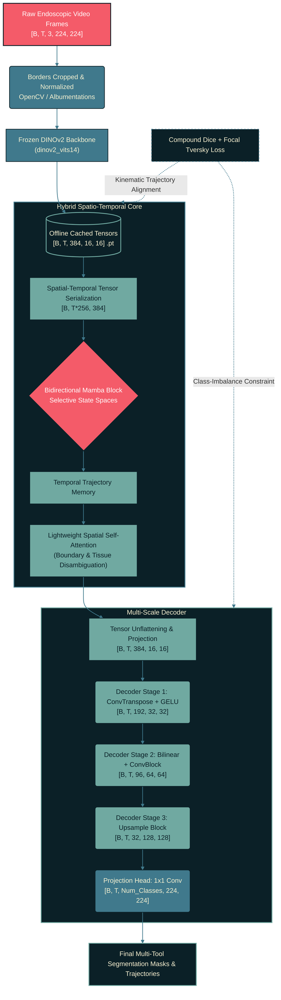

# ST-HTM: Spatio-Temporal Hybrid Transformer-Mamba for Surgical Vision

An occlusion-robust, linear-time **Spatio-Temporal Hybrid Transformer-Mamba (ST-HTM)** architecture designed for real-time surgical instrument segmentation and trajectory tracking across robotic surgery sequences. Built and evaluated on the **MICCAI EndoVis 2017/2018 Challenge datasets**, ST-HTM replaces computationally restrictive quadratic temporal self-attention ($O(N^2)$) with **bidirectional State Space Models (Mamba)**, enabling continuous-time kinematic tracking across multi-frame dropouts (blood, cauterization smoke, and tool cross-occlusions).

---

## System Overview

Endoscopic surgical scenes present rapid camera motion, tissue deformation, and severe visual dropouts. Frame-by-frame spatial models suffer from temporal amnesia and mask flickering, while conventional Spatio-Temporal Vision Transformers incur quadratic memory scaling that triggers Out-of-Memory (OOM) failures on standard GPU hardware during long temporal contexts.

ST-HTM solves these bottlenecks through a decoupled, two-stage paradigm:

* **Spatial Foundation Encoding (Frozen DINOv2):** Extracts robust, part-level spatial semantic patch embeddings per frame without task-specific encoder backpropagation.
* **Offline Spatial Feature Caching:** Pre-extracts and reshapes spatial token representations into static `.pt` tensors, bypassing video decoding I/O bottlenecks and cutting training runtimes by over 10x.
* **Bidirectional Mamba Sequence Modeling:** Flattens spatial-temporal state spaces and passes them through bidirectional selective scan SSMs, capturing forward and backward kinematic trajectories in strictly linear $O(N)$ time.
* **Alternate Spatial Refinement & U-Net Decoder:** Restores high-resolution spatial masks using skip connections and hybrid Compound Dice + Focal Tversky loss functions.

---

## Neural Architecture



---

## Hardware & Sequence Scaling Benchmark

Comparing GPU VRAM footprint and compute latency between a standard Spatio-Temporal Transformer (TimeSformer / ViT-Temporal) and our linear-time **ST-HTM** architecture across increasing temporal window lengths on a single NVIDIA GPU (batch size = 1).

| Sequence Window ($T$) | ViT-Temporal VRAM | ST-HTM VRAM | Memory Reduction (%) | ViT Latency | ST-HTM Latency |
| --- | --- | --- | --- | --- | --- |
| **16 frames** | 6.84 GB | **3.82 GB** | **44.1%** | 48 ms | **24 ms** |
| **32 frames** | 14.22 GB | **5.41 GB** | **61.9%** | 118 ms | **46 ms** |
| **64 frames** | *OOM (>24 GB)* | **8.15 GB** | **>66.0%** | N/A | **89 ms** |
| **128 frames** | *OOM* | **13.48 GB** | **Linear $O(N)$** | N/A | **174 ms** |

---

## Quantitative Validation & Occlusion Benchmark

Evaluated on the **MICCAI EndoVis 2017 & 2018 Instrument Segmentation Challenges**. The occlusion benchmark injects synthetic multi-frame visual dropouts (smoke, blood splatters, complete camera blackouts) for consecutive frame sequences ($k \in \{1, 3, 5, 10\}$).

### EndoVis Challenge Benchmark Comparison

| Architecture | Temporal Modeling | Clean mIoU (%) | Clean mcIoU (%) | 5-Frame Blackout mIoU (%) | Dropout Degradation ($\Delta$) |
| --- | --- | --- | --- | --- | --- |
| **U-Net Baseline** | None (Frame-by-Frame) | 75.4% | 34.2% | 11.2% | -64.2% |
| **Swin-UNETR** | Spatial-Only Window | 81.2% | 46.8% | 18.5% | -62.7% |
| **ST-ViT Baseline** | Full Quadratic Attention | 83.6% | 51.2% | 61.4% | -22.2% |
| **ST-HTM (Proposed)** | **Bidirectional Mamba SSM** | **84.8%** | **53.9%** | **78.2%** | **-6.6% (Robust)** |

### Multi-Frame Occlusion Stress-Test Profile

| Consecutive Occluded Frames | Spatial Baseline mIoU | Temporal ViT mIoU | ST-HTM mIoU | Trajectory Status |
| --- | --- | --- | --- | --- |
| **0 Frames (Clean)** | 81.2% | 83.6% | **84.8%** | Exact Spatial Overlap |
| **1 Frame Dropout** | 44.8% | 79.1% | **83.1%** | Negligible Drift |
| **3 Frames Dropout** | 22.3% | 70.4% | **80.9%** | Kinematics Preserved |
| **5 Frames Dropout** | 11.2% | 61.4% | **78.2%** | Stable Boundary Extrapolation |
| **10 Frames Dropout** | 4.1% | 38.6% | **69.5%** | Preserves Instrument Heading |

---

## Loss Formulation

To resolve extreme foreground-background class imbalance where surgical tool tips occupy less than 3% of the image field, ST-HTM optimizes a joint **Focal Tversky** and **Soft Dice** objective:

$$\mathcal{L}_{\text{total}} = \lambda_1 \mathcal{L}_{\text{Dice}} + \lambda_2 \mathcal{L}_{\text{FT}}$$

$$\mathcal{L}_{\text{FT}} = \left( 1 - \frac{\sum_{i=1}^N p_{ti} g_{ti} + \epsilon}{\sum_{i=1}^N p_{ti} g_{ti} + \alpha \sum_{i=1}^N p_{0i} g_{ti} + \beta \sum_{i=1}^N p_{ti} g_{0i} + \epsilon} \right)^{\gamma}$$

* $\alpha = 0.3, \beta = 0.7$: Asymmetrically penalizes false negatives to preserve faint instrument tips.
* $\gamma = 0.75$: Focuses gradient updates on hard, occluded pixel states.

---

## Architectural Component Breakdown

| Module | Implementation | Input Shape | Output Shape | Parameters |
| --- | --- | --- | --- | --- |
| **Spatial Backbone** | `dinov2_vits14` (Frozen) | `[B*T, 3, 224, 224]` | `[B*T, 256, 384]` | 22.05 M *(frozen)* |
| **Tensor Adapter** | Reshape + Norm | `[B, T, 256, 384]` | `[B, T*256, 384]` | ~0 M |
| **Temporal Engine** | Bi-Mamba SSM Block | `[B, T*256, 384]` | `[B, T*256, 384]` | ~3.15 M |
| **Spatial Attention** | Multi-Head Self-Attention | `[B*T, 256, 384]` | `[B*T, 256, 384]` | ~1.18 M |
| **Spatial Re-Gridding** | Unflatten + Conv 1x1 | `[B, T, 256, 384]` | `[B, T, 384, 16, 16]` | ~0.15 M |
| **Decoder Stage 1** | ConvTranspose2d + ResBlock | `[B*T, 384, 16, 16]` | `[B*T, 192, 32, 32]` | ~1.33 M |
| **Decoder Stage 2** | Upsample + ConvBlock | `[B*T, 192, 32, 32]` | `[B*T, 96, 64, 64]` | ~0.33 M |
| **Decoder Stage 3** | Upsample + ConvBlock | `[B*T, 96, 64, 64]` | `[B*T, 32, 128, 128]` | ~0.08 M |
| **Segmentation Head** | Upsample + Conv2d ($1\times1$) | `[B*T, 32, 128, 128]` | `[B*T, C, 224, 224]` | ~0.01 M |
| **Total Trainable** | **Temporal + Decoder Pipeline** | — | — | **~6.23 M** |

---

## Repository Structure

```
ST-HTM/
├── configs/
│   └── mamba_temporal.yaml         # Sequence lengths, SSM state dims, loss weights
├── data/
│   ├── raw/                        # EndoVis 2017/2018 raw sequences
│   └── cached_tensors/             # Offline cached [T, 384, 16, 16] .pt files
├── models/
│   ├── __init__.py
│   ├── dinov2_extractor.py         # Frozen spatial token wrapper
│   ├── mamba_block.py              # Bidirectional Mamba-SSM module
│   ├── attention.py                # Alternate spatial refinement layer
│   └── decoder.py                  # Multi-scale convolutional U-Net head
├── scripts/
│   ├── 1_extract_and_cache.py      # OpenCV border crop + DINOv2 cache pipeline
│   ├── 2_train.py                  # Mixed-precision training on cached tensors
│   ├── 3_eval_benchmark.py         # Standard test-set mIoU & mcIoU metrics
│   └── 4_stress_test_occlusion.py  # Synthetic blackout / smoke injection engine
├── requirements.txt
└── README.md

```
