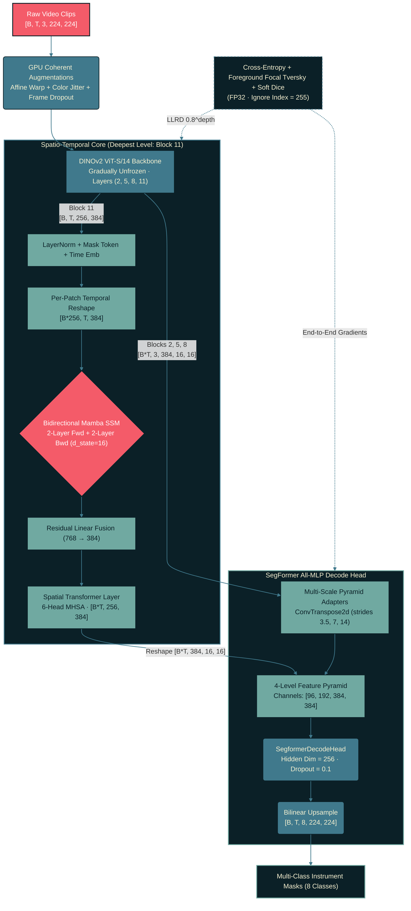

<div align="center">

# ST-HTM: Spatio-Temporal Hybrid Transformer-Mamba

**Gradually Unfrozen DINOv2 · Bidirectional Temporal Mamba · Multi-Scale SegFormer**

<p align="center">
  
  
  
  
  
</p>

<p align="center">
  <a href="results/report.md"></a>
  <a href="results/report.md"></a>
  <a href="results/report.md"></a>
  <a href="results/hardware.png"></a>
  <a href="results/metrics.json"></a>
  <a href="https://huggingface.co/datasets/tyluan/Endovis2017"></a>
</p>
</div>

---

**ST-HTM** is a fast, occlusion-aware video segmentation model built for robotic surgery on the **MICCAI EndoVis 2017** dataset. It combines a **gradually unfrozen DINOv2 ViT-S/14** backbone, **bidirectional Mamba** layers for linear-time temporal tracking, a lightweight spatial Transformer, and a **SegFormer All-MLP decoder** to segment 8 surgical instrument classes cleanly across video frames.

---

## Visual Showcase

#### Clean Unseen Video Prediction (`seq10.mp4`)

https://github.com/user-attachments/assets/c678d57d-d7a4-404e-8ea0-220c84765402

#### Simulated Multi-Frame Occlusion Test (`seq10_occlusion.mp4`)

https://github.com/user-attachments/assets/e99d59dd-03a4-4adf-9a3e-fea554edeaf0

<details>
<summary><b>View Keyframe Stills (Input | ST-HTM Prediction | Expert Ground Truth)</b></summary>
<br>
<p align="center">
  
  
</p>
</details>

---

## How It Works

Surgical video is hard for standard vision models: metallic tools reflect light, blood and tissue move constantly, and the camera shifts quickly. Frame-by-frame models flicker between frames, while full spatio-temporal Transformers run out of memory on long clips.

ST-HTM solves this with four simple ideas:

- **Clean, Video-Ordered Caching (`prepare_cache.py`):** Downloads `tyluan/Endovis2017`, rebuilds the true video frame order, applies one fixed crop per video to remove black borders, cleans noisy mask edges (`IGNORE = 255`), and saves `448×448` `uint8` tensors to `data/frames/`.
- **Gradual Backbone Unfreezing (`model.py`, `train.py`):** Starts with DINOv2 frozen so the new head can stabilize, then unfreezes 3 Transformer blocks at a time (epochs `4, 7, 10, 13`, and embeddings at `16`) using layer-wise learning rate decay (`0.8^depth`).
- **Linear-Time Temporal Tracking (`BiTemporalMamba`):** Runs forward and backward 2-layer Mamba SSMs (`d_state = 16`) per spatial patch across time in $O(T)$ time, with a learned `mask_token` for hidden or occluded frames.
- **Multi-Scale SegFormer Decoding:** Pulls features from 4 DINOv2 blocks `(2, 5, 8, 11)`, refines the deepest level with BiMamba and a 6-head spatial Transformer, builds a 4-level feature pyramid, and decodes masks with `SegformerDecodeHead`.

---

## Architecture



### Built With

<div align="center">

| Component | Tools & Libraries | Role |
| :---: | :---: | :---: |
| **Backbone** | `dinov2_vits14` (`torch.hub`) | Extracts multi-layer visual features (blocks `2, 5, 8, 11`) with gradual unfreezing |
| **Temporal Engine** | `MambaModel` (`transformers`), optional `mamba_ssm` & `causal_conv1d` | Forward & backward per-patch SSMs (`d_state=16`) with PyTorch reference fallback |
| **Decoder** | `nn.TransformerEncoderLayer`, `SegformerDecodeHead` | Spatial refinement and 4-scale pyramid fusion into 8-class segmentation logits |
| **Loss & Optimizer** | Custom FP32 `FocalTverskyDiceLoss`, Fused `AdamW`, Cosine Warmup | Handles extreme class imbalance while ignoring noisy mask edges (`255`) |
| **Training** | `torch.distributed` (DDP), `SyncBatchNorm`, `torch.amp` (`FP16`/`BF16`) | Dual-T4 / A100 training with coherent GPU-side clip augmentations (`F.affine_grid`) |
| **Data & Video** | Hugging Face `datasets`, `OpenCV`, `NumPy`, `imageio[ffmpeg]`, `Matplotlib` | Dataset caching, mask cleanup, profiling plots, and side-by-side MP4 rendering |

</div>

---

## Validation Results (EndoVis 2017)

Tested on the full validation split (`901` frames across `10` sequences, upsampled to `448×448` before `argmax`) using the **Epoch 15** checkpoint (`best_st_htm.pt`, `224×224` input). Multi-class means are averaged over tool classes present in the ground truth (`support > 0`).

### Overall Performance

<div align="center">

| Split | mIoU (%) | mDice (%) | mPrecision (%) | mRecall (%) | Pixel Acc (%) | Binary Tool IoU (%) | Binary Tool Dice (%) |
| :---: | :---: | :---: | :---: | :---: | :---: | :---: | :---: |
| **All Validation (Seq 1–10)** | **84.22%** | **91.05%** | 90.68% | 92.58% | 98.30% | **91.02%** | **95.30%** |
| **Seen Videos (Seq 1–8)** | 84.48% | 91.23% | 90.76% | 92.79% | 97.76% | 89.36% | 94.38% |
| **Unseen Videos (Seq 9–10)** | **91.58%** | **95.57%** | 93.42% | 97.99% | 99.36% | **95.13%** | **97.50%** |

</div>
> *Note:* Sequences 9 (1 frame) and 10 (300 frames, `large_needle_driver`) are completely unseen surgical videos during training.
<p align="center">
</p>
### Per-Class Breakdown

<div align="center">

| Instrument Class | IoU (%) | Dice (%) | Precision (%) | Recall (%) | Specificity (%) | GT Pixels |
| :---: | :---: | :---: | :---: | :---: | :---: | :---: |
| `background` | 98.57% | 99.28% | 99.56% | 99.01% | 97.05% | 154,896,099 |
| `large_needle_driver` | **95.51%** | **97.70%** | 98.21% | 97.20% | 99.86% | 13,191,949 |
| `monopolar_curved_scissors` | **93.77%** | **96.79%** | 95.16% | 98.47% | 99.97% | 1,182,014 |
| `vessel_sealer` | **85.71%** | **92.31%** | 96.32% | 88.61% | 99.96% | 2,281,336 |
| `bipolar_forceps` | **80.00%** | **88.89%** | 95.48% | 83.15% | 99.90% | 4,499,395 |
| `prograsp_forceps` | 66.09% | 79.58% | 68.22% | 95.49% | 99.49% | 2,036,336 |
| `grasping_retractor` / `other` | — | — | — | — | 99.99% / 99.50% | 0 *(absent in val)* |

</div>
<p align="center"></p>
<p align="center"></p>

### Temporal Stability (Per-Sequence Highlights)

Prediction flicker (the share of pixels changing class between consecutive frames) stays closely aligned with ground-truth motion:

<div align="center">

| Sequence | Split | Frames | mIoU (%) | Tool IoU (%) | Pred Flicker (%) | GT Flicker (%) |
| :---: | :---: | :---: | :---: | :---: | :---: | :---: |
| **Seq 3** | Seen | 75 | 95.70% | 95.70% | 12.50% | 12.37% |
| **Seq 4** | Seen | 75 | 94.21% | 95.25% | 7.86% | 7.62% |
| **Seq 5** | Seen | 75 | 92.07% | 92.68% | 11.84% | 11.58% |
| **Seq 8** | Seen | 75 | 95.66% | 95.87% | 11.93% | 11.80% |
| **Seq 10** | **Unseen** | 300 | **95.25%** | **95.13%** | **10.10%** | **10.17%** |

</div>
<p align="center"></p>
<p align="center"></p>

### Occlusion Stress Test

Consecutive frames ($k$) are blacked out and replaced with the learned `mask_token`, then scored strictly on the hidden frames:

<div align="center">

| Hidden Frames ($k$) | Hidden-Frame mIoU (%) | Hidden-Frame Tool IoU (%) |
| :---: | :---: | :---: |
| **0 (Clean Baseline)** | 60.15% *(84.22% GT-present)* | **91.02%** |
| **1 Frame Hidden** | 39.87% | **48.63%** |
| **2 Frames Hidden** | 36.25% | **41.91%** |
| **3 Frames Hidden** | 30.85% | **33.00%** |
| **5 Frames Hidden** | 20.06% | **21.02%** |
| **8 Frames Hidden** | 10.54% | **7.98%** |
| **10 Frames Hidden** | 9.94% | **9.27%** |

</div>
<p align="center"></p>

---

## Hardware & Scaling Benchmark

Measured on a single **NVIDIA Tesla T4** (`PyTorch 2.11.0+cu130`, `FP16`, `224×224` input, unfused PyTorch Mamba scan).

- **Model Size:** `29.21M` parameters (`22.06M` DINOv2 + `7.15M` temporal/SegFormer head) · `111.4 MB` FP32
- **Compute:** `18.40 GFLOPs / frame` (`12.25` DINOv2 + `6.15` head)
- **Online Streaming (1 new frame + cached 16-frame window):** `97.0 ms / frame` (`8.45 ms` DINOv2 + `88.57 ms` unfused head) = **10.3 FPS** at **856 MB** peak VRAM

### Clip Length Scaling (Batch Size = 1)

<div align="center">

| Clip Length ($T$) | p50 Latency (ms) | p95 Latency (ms) | Throughput (FPS) | Peak VRAM (MB) |
| :---: | :---: | :---: | :---: | :---: |
| **4 frames** | 29.8 ms | 31.4 ms | 133.6 FPS | 384 MB |
| **8 frames** | 55.1 ms | 55.5 ms | 145.2 FPS | 607 MB |
| **16 frames** | 111.5 ms | 112.4 ms | 143.6 FPS | 891 MB |
| **32 frames** | 228.0 ms | 232.9 ms | 139.9 FPS | 1,620 MB |
| **64 frames** | 479.1 ms | 484.6 ms | 133.5 FPS | 3,077 MB |

</div>

### Batched Throughput ($T = 16$)

<div align="center">

| Clips / Batch | p50 Latency (ms) | p95 Latency (ms) | Throughput (FPS) | Peak VRAM (MB) |
| :---: | :---: | :---: | :---: | :---: |
| **1** | 105.7 ms | 106.5 ms | 151.3 FPS | 891 MB |
| **2** | 206.7 ms | 209.2 ms | **154.7 FPS** | 1,940 MB |
| **4** | 417.7 ms | 420.6 ms | 153.2 FPS | 3,717 MB |
| **8** | 866.5 ms | 871.8 ms | 148.0 FPS | 7,273 MB |

</div>
<p align="center"></p>

---

## Loss Function

Computed in `FP32` over valid pixels (`target != 255`) in `loss.py`, combining **Cross-Entropy**, **Foreground Focal Tversky**, and **Soft Dice**:

$$\mathcal{L}_{\text{total}} = \mathcal{L}_{\text{FT}} + \mathcal{L}_{\text{Dice}} + \lambda_{\text{CE}}\,\mathcal{L}_{\text{CE}}$$

$$\mathcal{L}_{\text{FT}} = \frac{1}{\vert{}C_{\text{fg}}\vert{}} \sum_{c \in C_{\text{fg}}} \left( 1 - \frac{\text{TP}_c + s}{\text{TP}_c + \alpha\,\text{FN}_c + \beta\,\text{FP}_c + s} \right)^{\gamma}$$

- $\alpha = 0.7,\ \beta = 0.3$: Penalizes missed tool pixels more heavily so thin shafts and jaws aren't lost.
- $\gamma = 0.75,\ \lambda_{\text{CE}} = 1.0,\ s = 1.0$: Keeps focus on hard boundaries while stabilizing probabilities.

---

## Repository Structure

```text
ST-HTM/
├── install_kernels.py      # Optional prebuilt CUDA wheel installer (causal_conv1d & mamba_ssm)
├── prepare_cache.py        # Downloads EndoVis 2017, cleans masks, crops borders, caches 448px .pt files
├── model.py                # DinoBackbone (gradual unfreeze), BiTemporalMamba, Spatial Transformer & SegFormer head
├── loss.py                 # FP32 FocalTverskyDiceLoss (CE + Focal Tversky + Soft Dice)
├── train.py                # Single/Multi-GPU DDP training, GPU augmentations, LLRD, auto-resume & early stopping
├── infer.py                # AMP helpers, checkpoint loader & sliding-window predict_sequence()
├── test.py                 # Full evaluation: accuracy, occlusion sweep, flicker stability, FLOPs/VRAM & plots
├── make_video.py           # Side-by-side MP4 renderer (input | prediction | ground truth + occlusion demo)
├── checkpoints/            # best_st_htm.pt, last.pt, history.json
└── results/                # report.md, metrics.json, per_class.csv, plots & videos/
```

---

## Quickstart

```bash
# 1. Install dependencies & optional fused Mamba CUDA kernels
pip install -q transformers datasets opencv-python-headless "imageio[ffmpeg]" matplotlib
python install_kernels.py

# 2. Download EndoVis 2017 and build sequence-ordered 448px cache
python prepare_cache.py

# 3. Train (single GPU or multi-GPU DDP; auto-resumes from checkpoints/last.pt)
torchrun --standalone --nproc_per_node=2 train.py

# 4. Run full evaluation, occlusion stress test, hardware benchmark & plot generation
python test.py

# 5. Render showcase videos (clean + simulated occlusion)
python make_video.py --seqs 10
python make_video.py --seqs 10 --occlusion-demo
```
